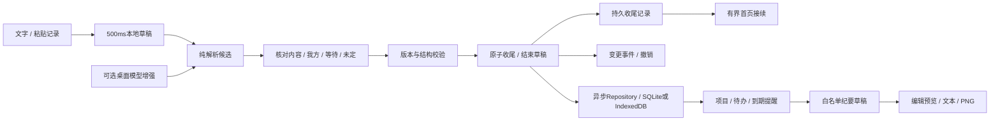

# Looma（灵犀胶囊）系统技术架构与数据字典规范

版本：v5.0 · 批准日期 2026-10-27。本文记录已批准的架构契约。详细定义以源码为准，实现与检查结果见implementation-v5-status.md；v4历史验证不自动视作v5通过。

## 一、技术边界与总体架构

复用 Electron 34、React 19、TypeScript 5.7、Vite 6、Tailwind CSS 与 HTML2Canvas。用户批准新增better-sqlite3@12.11.1，桌面采用SQLite，浏览器采用原生IndexedDB；不新增测试框架、向量库或官方云服务。Electron34.5.8的Node20.19.1、ABI132已经实际加载对应原生二进制，安装后脚本核对并准备当前Electron版本的构建。



候选解析无业务持久化副作用；原文归档和草稿保存不表示确认业务。模型和本地规则共享候选边界，commitCapture成功才生成收尾回执。自然语言和工作记忆提取不能绕过核对；明确完成或重新打开操作通过同一仓储事务与事件机制直存。

## 二、数据字典与接口

| 类型 | 职责与重要字段 |
| --- | --- |
| `WorkspaceMode` | `life` 或 `work`，仓储访问必须显式指定 |
| `AppSnapshotV5` | schemaVersion为5的有界UI缓存，每类近期最多50条；AppSnapshotV4兼容别名不代表旧备份格式 |
| `Engagement` | 客户合作项目：ID、客户名、项目标题、可未知预算、阶段、内部资料、可外发摘要、下一步和更新时间 |
| `ProjectTaskItem` | 兼容旧任务，扩展可选项目关联、确认后到期时间与原始日期表达 |
| `ProposedChangeSet` | 候选ID、来源与原文、所属空间、基础版本、操作、警告与可选归属追问；操作支持followup |
| `CommittedChangeEvent` | 已提交批次、字段前后值、来源与提交时间，为撤销提供依据 |
| `StateMutationReceipt` | 提交成功后的界面回执，不承担候选或写入职责 |
| `AlignmentDraft` | 独立外发草稿，仅包含用户选择且允许外发的信息 |
| `ManagedMemory` | 已确认事实及active/superseded/retracted状态、主体、主题、置顶、来源和替代关系 |
| `MemorySummary` | 来源明确的本地可重建摘要，不承担事实或当前业务状态职责 |
| `CaptureDraft` | id固定active-work、唯一sessionId、原文、显式归属、来源版本、编辑版本、候选及冲突、编辑或核对状态、保存时间 |
| `FollowUpItem` | waiting或question、项目关联、开放或已处理状态、来源、可选预计日期/时刻、用户自设reviewAt |
| `ClosureRecord` | 来源、提交事件、项目/行动/跟进项引用、核对与撤销时间，可标记仅存原文；不另复制原文 |
| `CaptureCommitResult` | committed、rejected或unknown，区分业务写入、结果不确定和刷新警告 |

核心服务接口：

```typescript
StateEngine.propose(text, context): ProposedChangeSet
StateEngine.validate(proposal, partition): string[]
Repository.initialize(): Promise<Bootstrap>
Repository.commit(proposal): Promise<MutationResult>
Repository.getCaptureDraft(): Promise<CaptureDraft | null>
Repository.saveCaptureDraft(draft): Promise<void>
Repository.commitCapture(draft, originalOnly?): Promise<CaptureCommitResult>
Repository.getWorkHome(now?): Promise<WorkHome>
Repository.setItemState(kind, item, done): Promise<CaptureCommitResult>
Repository.undo(space, eventId?): Promise<MutationResult>
Repository.query(space, kind, options): Promise<QueryPage>
Repository.getCurrent(): AppSnapshotV5 // 已加载缓存，不读取整库
Repository.subscribe(listener): () => void
```

`context` 包括显式空间、稳定来源、当前分区、输入时间、可选目标项目及用户显式输入的新客户/项目。普通姓名没有明确绑定时不自动新建。提交负责结构、实体、幂等、前值和版本校验；撤销按倒序，仅允许指定事件确为最近事件时撤销。UI不能直接改数组绕开事件。

`saveDraft`只写工作空间active-work记录，不递增业务版本或产生撤销事件；同session拒绝较旧编辑版本，已提交session标记阻止迟到保存复活草稿。`commitCapture`固定来源和候选ID，在同一事务中归档必要来源、提交业务与事件、生成closure并删除草稿；重复相同命令不要求草稿仍存在。originalOnly只接受空业务操作，并准确标记回执。

Repository将ACK后刷新失败作为committed附refreshWarning返回；失去ACK时按稳定closure ID查询，未能核查则unknown，保留原命令和草稿。不能因重试生成新批次。三方合并以候选前值、当前值和用户编辑为依据，保留不冲突编辑，对冲突字段逐项选择。

快照中的公开设置排除 Key；`AppSettings` 中可选的旧 `apiKey` 字段仅用于迁移兼容，不作为持久化公开设置或正常模型调用来源。

## 三、存储、迁移和原子恢复

桌面由主进程独占`userData/looma.sqlite`，SQLite WAL、FULL同步、事务和索引负责持久化；renderer通过来源校验的有限命令IPC调用，不接收原始SQL。浏览器沿用IndexedDB名称`looma-local-v4`，v5原地升级结构、索引与记录包装，不创建空库取代原资料。记录仍以records、terms、meta和processed维护。所有访问强制life/work，新三类记录只允许work。

每条记录保存space、kind、id、data、at；账本配置与expense分开，避免账单数组随历史增长。事务校验批次内容、基础版本、字段前值与实体引用；成功后才刷新UI缓存。批次ID与内容摘要绑定，重复相同命令幂等，不同内容复用ID报错。写入失败不得部分提交或报成功。业务数据库未加密，分区不是物理隔离。

首次先校验旧v3快照，再按来源指纹一次迁入；旧版更早资料经既有迁移器读取实际键，不生成示例。旧日记和CRM等归属沿用v3规则，未关联任务不猜测项目。旧非凭据键保留回退，正常运行只读新仓储；旧版已截断的历史不可恢复。新用户为空白业务区。

完整备份v5包含records、applied幂等记录、设置与版本。桌面JSONL流式导出，带结束计数及SHA256，接受v4/v5文件，先写暂存库完整校验再替换；坏DB保留不可读原文件后恢复有效备份。Web JSON接受looma-v4、looma-v5及v3完整快照，缺少新集合按空处理；使用一致只读事务导出，单写事务原子恢复。索引升级失败随升级事务回退。无5MB硬上限，浏览器全备份仍需足够内存；无效备份不得部分覆盖，凭据不进入备份。

生活态先在detached draft计算差异，再单事务更新，按来源ID幂等，原文和回复分别保存；短缓存保存不得截断旧档案。业务成功但回复失败时提示勿重复提交。按空间分开控制刷新序列，旧响应不能覆盖当前界面或新设置。正常列表有界，完整遍历仅用于用户明确要求的备份、恢复或维护。

工作首页按状态与提醒时间索引查询，每组最多3项并返回计数，不通过前端读全库筛选。今日与逾期按上海自然日分组；等待、未定和最近收尾独立查询。常规列表沿用游标分页。

检索使用结构化ID/关联过滤、全文资料与中文相邻双字索引；单字查询需限定实体。自然语言回忆采用有限关键词候选合并，当前业务值优先，最终最多12条、约4800字符。来源关系使被替代/忘记事实及关联摘要退出默认回忆。主动删原文时，同事务移除关联草稿、事件原文副本和可恢复原文的撤销内容；清理原文缓存和派生展示，独立业务字段仍保留，旧备份需另行处理，未承诺物理擦除。

## 四、解析、并发与日期约束

规则解析只覆盖已测试句式。金额按显式单位转换，“300 元”保持 300，“从 8 万改为 12 万”取最终值；缺单位不猜测。否定、假设和不明确人物不产生确定的赢单或覆盖操作。同一客户多项目时选择目标，不能默认修改第一条。

一次输入版本对应稳定来源和批次，同一候选重复确认不重复写入。候选携带基础版本，后续编辑后旧预览先重核，不能覆盖新值。草稿保留手改和冲突，确认、忽略、手改或切换空间后迟到模型不得覆盖新状态。异步请求固定发起空间，不能跨区展示。

日期以输入时的Asia/Shanghai时间为锚点，预览显示绝对日期。我方待办仅日期无时刻默认09:00提醒；客户预计日期保存expectedDate，明确时刻才保存expectedAt，不补时刻为客户承诺。reviewAt是用户主动设置的回访时间，缺失不自动催促；未定费用保存问题，不改成确定预算。提醒只在应用运行（含胶囊）时工作，重开汇总遗漏，系统通知不含客户细节。

## 五、桌面模型边界与凭据

模型凭据由 Electron 主进程使用当前版本支持的 `safeStorage` 保存，安全存储不可用时仅在会话中使用，不明文落盘。界面保存后只获取是否配置、是否启用、持久化状态及非敏感连接资料，不获取 Key。旧明文 Key 仅在安全迁移成功后移除。

桌面每次启动尝试migrateLegacyConnection。已有连接、Ollama或暂不可读的凭据文件不覆盖，旧连接另存系统加密归档looma-legacy-connection.json。加密落盘成功后才清理旧localStorage凭据，失败下次重试。清除配置同时清除当前连接和旧连接归档。

主进程代发 OpenAI 兼容 `/chat/completions` 请求，可连接用户自己的服务或本地 Ollama。远程要求 HTTPS，HTTP 只允许 loopback；拒绝 URL 凭据和不允许的地址组成部分，限制重定向。请求设置超时与取消，错误不打印凭据或业务正文。

模型只接收当前输入和所选项目必要字段，默认不附加内部资料、全部历史或另一空间。响应经过 JSON 结构、字段白名单、目标实体和数值校验后生成候选，不执行模型提供的代码、工具调用或存储命令。Web 预览不调用桌面凭据接口，只运行本地流程。

memoryModelEnabled是独立、默认关闭的授权。回忆模型只接收当前问题和用户已经展示核对的当前空间证据，最多20条、8000字符；主进程再查授权、限制字段和长度，无业务写工具。事实、摘要和历史的优先级与来源标签作为资料进入提示，不允许原文指令覆盖系统约束。角色采用本地SVG/CSS，遵从减少动态效果；胶囊复用原窗口并恢复展开边界。

保留 `contextIsolation`、关闭 Node 集成、启用 `webSecurity`；限制页面导航、新窗口和 IPC 发送来源。来源验证和模型输出验证是独立边界，不能由提示词代替。

## 六、外发草稿与工程验证

外发草稿从明确白名单构造，内部备注不属于草稿结构。预算默认不选；原文、另一空间和未经选择的待办不进入导出。自由文本即使属于允许字段，也仍需用户在完整预览中核对，不宣称自动识别所有敏感文字。

自动化使用Node内置测试与TypeScript，覆盖解析、事务、撤销、幂等、迁移、恢复、失败、日期与隔离；浏览器验证完整交互及PNG，Electron另测本地启动、凭据、模型、通知和窗口。

集成脚本通过LOOMA_PLAYWRIGHT_MODULE使用外部Playwright；当前执行入口与真实结果见v5实施记录，v4脚本保留历史场景。Node主机与原生SQLite测试分开运行，后者通过scripts/test-native.cjs启动Electron匹配ABI；覆盖草稿、原子收尾、幂等、未知ACK、刷新失败、冲突、明确操作、迁移/备份、删除及万条历史有界查询。浏览器与Electron均需完整旅程实跑。

本次受控模型验证不代表真实云服务准确率。npm官方审计报告Electron/extract-zip两项高危，发布前须升级复测；静态检查不代替运行与Word逐页复核。
