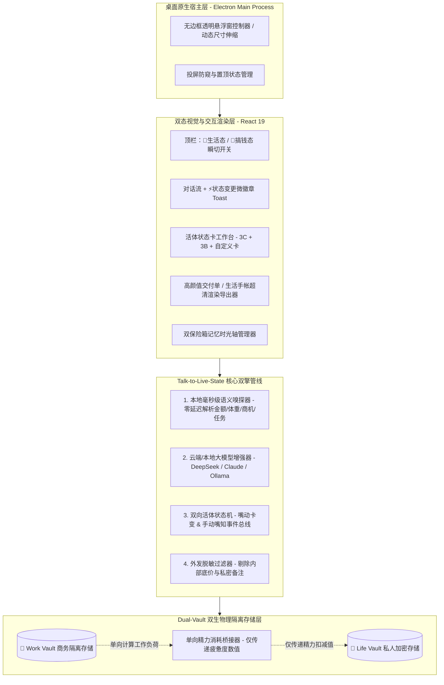

# Looma（灵犀胶囊）系统技术架构与数据字典规范 (Technical Architecture & Data Schema)

> **文档版本**：v2.0  
> **技术栈底座**：Electron 34 + Vite 6 + React 19 + TypeScript 5 + TailwindCSS + HTML2Canvas  
> **核心工程目标**：毫秒级本地意图嗅探响应、100% 物理隔离的双保险箱存储、离线/在线无缝双模运行。

---

## 一、 总体系统架构图 (System Architecture)



---

## 二、 核心数据字典与 TypeScript 接口规范 (Data Dictionary)

### 2.1 全局空间模式与双保险箱定义
```typescript
// 双态空间枚举：生活态 (ToC) vs 搞钱态 (ToB)
export type WorkspaceMode = 'life' | 'work';

// 状态变更回执（用于在聊天气泡下方渲染可点击的“⚡状态已自动更新”胶囊）
export interface StateMutationReceipt {
  id: string;
  mode: WorkspaceMode;
  targetCardType: 'wallet' | 'rpg_status' | 'relationships' | 'crm' | 'projects' | 'custom';
  targetCardTitle: string;
  summaryText: string; // 例如："💰 随口记账：记入支出 ¥45.00（午饭）"
  deltaBadge: string;  // 例如："-¥45" 或 "进度 → 80%"
  timestamp: number;
}
```

### 2.2 ToC【🌙 生活态】三大活体状态卡数据结构
```typescript
// C1: 💰 随口记账与心愿小金库
export interface ExpenseEntry {
  id: string;
  title: string;
  amount: number;
  type: 'expense' | 'income' | 'saving';
  category: '餐饮☕' | '购物🛍️' | '出行🚕' | '娱乐🎮' | '生活🏠' | '金库✨';
  timestamp: number;
}

export interface WalletCardState {
  monthlyBudget: number;
  wishTitle: string;
  wishTarget: number;
  wishSaved: number;
  entries: ExpenseEntry[];
}

// C2: ⚡ 三维人生状态栏 (RPG 个人面板)
export interface RpgStatusCardState {
  energy: number;       // 0 - 100 精力值
  waterCups: number;    // 今日饮水杯数 (目标 8 杯)
  weightKg: number;     // 当前体重
  targetWeightKg: number;
  moodBuff: string;     // 当前状态 Buff，如 "🔥 灵感迸发" / "😴 急需补觉"
  streakDays: number;   // 连续健康打卡天数
}

// C3: ❤️ 人间关系与重要人脉备忘录
export interface PersonProfile {
  id: string;
  name: string;
  relation: string;     // 如 "挚友" / "家人" / "重要伙伴"
  taboos: string[];     // ⚠️ 忌口与雷区（如 "海鲜过敏"、"不吃香菜"）
  preferences: string[];// 🎁 喜好与心愿（如 "喜欢乌龙茶"、"猫奴"）
  nextImportantDate?: string; // 如 "生日 11-15"
  updatedAt: number;
}
```

### 2.3 ToB【💼 搞钱态】三大活体状态卡数据结构
```typescript
// B1: 🤝 零填表·客户商机跟进卡 (轻量活体 CRM)
export type DealStage = '初步接触' | '需求确认' | '方案报价' | '商务谈判' | '赢单成交';

export interface CrmDealItem {
  id: string;
  clientName: string;       // 如 "星辰科技·李总"
  budgetAmount: number;     // 预计金额（元）
  stage: DealStage;
  winProbability: number;   // 预计赢率 20% - 100%
  painPoints: string;       // 客户核心痛点（对外脱敏时可转为“核心诉求”）
  internalBottomLine: string; // 🔒 内部底线/备注（一键外发时绝对隐藏！）
  nextAction: string;       // 下一步跟进动作与死线
  updatedAt: number;
}

// B2: 🎯 碎碎念·项目死线推进看板
export interface ProjectTaskItem {
  id: string;
  title: string;
  assignee: string;
  deadline: string;
  priority: 'high' | 'medium' | 'low';
  done: boolean;
}

// B3: 📤 一键外发·客户交付对齐回执单 (从 B1/B2 自动脱敏合成)
export interface ClientAlignmentPoster {
  id: string;
  clientName: string;
  projectName: string;
  consensusList: string[];  // 已达成共识项
  nextDeliverables: string[]; // 我方下一步交付承诺
  clientTodo: string;       // 需客户配合确认项
  generatedDate: string;
}
```

### 2.4 一句话自定义新活体卡数据结构
```typescript
export interface CustomLivingCard {
  id: string;
  mode: WorkspaceMode;
  title: string;
  icon: string;
  metricLabel: string;
  metricValue: number;
  metricTarget: number;
  unit: string;
  checklist: { id: string; text: string; done: boolean }[];
  notes: string;
}
```

---

## 三、 Talk-to-Live-State 混合嗅探与状态差分算法

为了做到**“无论用户是否配置 API Key，都能在 0.2 秒内实现说话即建卡改数”**，系统采用 **本地确定性语义规则引擎（Tier-0）+ 大模型结构化提取（Tier-1）** 的双层混合架构：

1. **Tier-0 本地毫秒级语义嗅探器（Local Deterministic Sniffer）**：
   * **记账与金库嗅探**：自动捕获 `(花了|买了|吃了|打车|消费|付了)\s*(\d+(\.\d+)?)` 以及 `(存入|攒了|发工资)\s*(\d+)`，自动判定分类并写入 `WalletCardState`，生成 `StateMutationReceipt`。
   * **身体与精力嗅探**：自动捕获 `体重\s*(\d+(\.\d+)?)`、`喝水`、`熬夜|好累|加班`（动态增减精力值并更换 Buff）、`跑步|健身|运动`。
   * **人脉档案嗅探**：自动捕获 `([^\s，。]{2,4})(不吃|讨厌|过敏|喜欢|爱喝|生日是)([^，。！？]+)`，自动合并或新建 `PersonProfile`。
   * **客户 CRM 嗅探（ToB）**：自动捕获 `([A-Za-z0-9\u4e00-\u9fa5]{2,8}(?:总|经理|总监|老板|客户|公司))` + `预算\s*(\d+)\s*(万|元|k)?` + `(?:痛点是|需要|想做)([^，。]+)`，自动新建或更新对应的客户商机卡，并根据关键词（报价/谈判/签合同/成交）自动跃迁商机阶段！
   * **项目待办嗅探（ToB）**：自动捕获 `(周[一二三四五六日天]|明天|月底|\d+号)前?(?:要|完成|交|搞定)([^，。！？]+)`，自动拆解为带截止日期的高优待办项。
   * **一句话造新卡嗅探**：捕获 `(?:建一张|新建|创建)《?([^》”]+)》?卡`，自动实例化包含进度条与检查清单的 `CustomLivingCard`。

2. **公私物理隔离与单向精力桥接算法**：
   * `StorageService` 将本地存储键严格切分为 `looma_life_*` 与 `looma_work_*` 两个独立命名空间。
   * 当用户在 `work` 模式下新增商机或完成高优任务时，触发 `WorkLoadBridge.recordWorkIntensity(delta)`，仅向 `life` 模式的 `RpgStatusCardState.energy` 同步疲劳度扣减与温暖问候触发器，实现**“懂你的辛苦，但绝不窥探与泄露你的公私机密”**。
