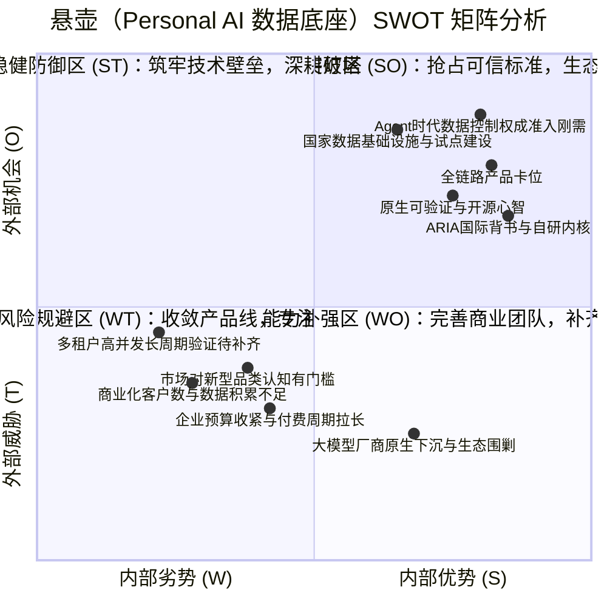
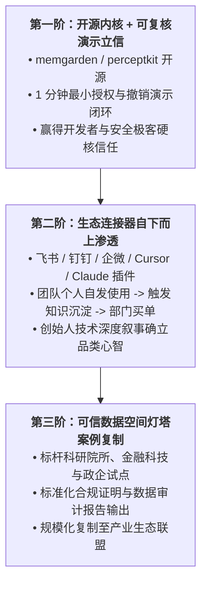

# 悬壶（杭州）艺术科技有限公司
## 面向 AI 智能体的可验证隐私数据底座
### Personal AI · 商业计划书（投资人评审与商业化定稿版）

---

## 一、公司与项目概览

### 1. 公司基本信息
- **公司名称**：悬壶（杭州）艺术科技有限公司
- **统一社会信用代码**：91330108MAD3A88Q3Y
- **成立日期**：2023 年 10 月 25 日
- **注册地址**：浙江省杭州市余杭区五常街道五常大道 168 号 C 幢 2 楼南 023 室
- **法定代表人**：谭晓婷（持股 85%）

### 2. 项目定位与核心命题
本项目定位为**“面向 AI 智能体的可验证隐私数据底座”**。

在通用大模型基础设施日趋成熟、推理成本持续走低的背景下，AI 竞争已从“单次问答工具”快速升级为“持续代表用户工作与生活的智能代理（Agent）”。当智能体开始长期读取邮件、日历、浏览器会话、屏幕状态、业务文档及个人敏感资产时，产业核心痛点已不再是“模型是否足够聪明”，而是**数据权利与控制权归属**：
- 智能体究竟获得了哪些权限？是否被严格限制在最小必要范围？
- 敏感数据在何种环境中被解密、计算与暂存？能否被云厂商或服务商暗中偷看？
- 用户更换大模型或服务商时，积累的记忆与关系上下文能否完整带走，还是被迫记忆清零？
- 服务商向企业或个人作出的隐私承诺，是否只能依靠文本免责声明，还是具备密码学与硬件级的独立核验证据？

悬壶不以训练通用基座大模型为目标，而是卡位大模型之下的**可信数据控制基础设施**。我们将“信任”从合规政策文本，转化为可授权、可验证、可迁移、可撤销的工程机制，让数据权利真正掌握在用户与机构手中。

### 3. 产品组合与商业推进逻辑
悬壶构建了“一套可信执行底座 + 三条主产品线 + 一个机构协作扩展”的完整产品栈：
1. **OAuth3（授权与凭证委托连接器）**：解决第三方智能体在无官方细粒度 API 场景下的数据安全接入，实现凭证密封托管、范围令牌（Scoped Token）与即时阻断撤销。
2. **Router（团队 AI 知识协作系统）**：将成员日常与 AI 交流中的高价值讨论，经本人主动确认后整理、脱敏并沉淀为可自托管的团队知识资产，切入 B2B 团队刚需。
3. **IO（端云飞地个人智能体）**：实现端侧最小感知、独立记忆生长内核（memgarden/perceptkit）、飞地加密计算与多运行时平滑切换，打造真正“带得走、永不熄灯”的 Personal AI。
4. **Hivemind（跨信任域受限协作）**：以签名房间与策略强制环境承载跨机构联合分析与数据协作，实现“可用不可见、计算受约束”。
5. **可信执行与核验底座**：基于 Intel TDX 机密虚拟机与 Phala dstack，提供统一远程证明（Remote Attestation）、代码身份度量与密钥封装服务。

**商业推进战略**：不盲目均摊资源，严格遵循**“先做高信任 B2B 交付与团队场景付费验证，再以连接器和个人运行时扩大生态边界”**的递进次序：
- **第一阶段（商业楔子）**：以 **Router** 解决技术团队核心知识静默流失痛点，验证 B 端付费与席位订阅；
- **第二阶段（能力外溢）**：**OAuth3** 作为连接器随 Router 客户自然延展，集成至主流 AI 工作流与企业应用；
- **第三阶段（长期战略）**：**IO** 在真实多端网络中持续迭代，确立 Personal AI 可信基础设施地位；
- **第四阶段（高客单机构）**：**Hivemind** 稳步切入科研联合攻关、供应链与可信数据空间试点。

项目所属课题已获得英国 **ARIA Scaling Trust 计划 90 万英镑**研发分包资助，拥有确定性的早期研发外汇现金流，为产品化与商业化拓展提供了坚实的技术与财务护城河。

---

## 二、市场背景与窗口

### 1. AI 智能体进入持续代理阶段
AI 产业正在经历从 Stateless（无状态单次对话）向 Stateful（持续状态代理）的历史性跨越。持续代理必须长期驻留、主动感知并积累情境上下文。然而，传统互联网“服务商集中托管明文”的模式在处理极度敏感的个人工作与生活数据时遭遇了根本性信任危机。用户与企业在面对强模型时，普遍存在“不敢把核心数据交出去”的顾虑。产品竞争的第一分水岭已从纯生成质量转向数据控制权的可靠性。

### 2. 国家数据要素与可信数据空间政策窗口
国家数据局《可信数据空间发展行动计划（2024—2028 年）》明确提出到 2028 年建设 100 个以上可信数据空间，将可信执行环境（TEE）、数据沙箱、使用控制与隐私计算确立为新型基础设施重点方向。杭州市承担国家数据基础设施试点，余杭区重点布局可信数据空间与区块链创新。国家政策为机构数据受控流通与本地化可信部署打开了明确的政企采购与示范场景。

### 3. 国际前沿研究议程同频共振
英国科学创新与技术部（DSIT）旗下高级研究与发明局（ARIA）设立“Scaling Trust”重大科研资助计划，将自主多智能体世界中的可信基础设施列为关键攻坚方向。悬壶作为课题研发承担方入选该体系，表明团队技术路线已接入全球顶级去中心化信任与硬件可信计算研究生态。

---

## 三、市场痛点

### 痛点一：授权即失控（全有或全无的会话暴露）
真实工作流中大量网站与内网系统缺乏面向第三方智能体的细粒度 OAuth 接口。为让智能体整理日程、发票、项目进度或会议记录，用户往往被迫交出账号密码或整份浏览器 Cookie。这种授权既无法限制读取资源与时效，也无法在保留自身登录状态的同时单独撤回智能体的访问权。一旦智能体被注入或凭证泄露，用户将承担不可逆的安全损失。

### 痛点二：换 AI 等于记忆清零（平台锁定与资产扣留）
用户使用 AI 三个月以上所积累的偏好习惯、项目情境和未言明的协作默契，是极高价值的“数字自我”。传统平台将记忆锁在私有数据库中，格式不透明、逻辑不可检。当用户因价格、隐私顾虑或模型能力跃迁希望更换底层大模型时，只能接受记忆清零。用户失去的是业务连续性与人机关系的沉淀。

### 痛点三：团队知识协作增长静默流失
研发与专业服务团队每天在个人 AI 对话窗口中解决大量复杂的架构设计、踩坑排错和业务决策。由于缺乏合理的共享机制，这些极具复用价值的经验沉淀留在个人本地，团队看不到也搜不到。现有企业知识库大多要求全量上传监控，侵犯员工私人工作空间；团队亟需“作者主动审核确认、一键脱敏路由”的知识沉淀机制。

### 痛点四：跨机构协作只能靠合同与平台承诺
跨机构科研合作、金融联合风控及供应链协同中，各方既需要基于联合数据得出高阶统计与模型推断，又绝对不能让原始数据离开本地边界。过往依赖保密协议（NDA）和事后审计的形式在智能体自治时代风险极高，市场迫切需要从代码和硬件层约束“能查什么字段、输出多大熵值、超出限额自动熔断”。

---

## 四、解决方案与产品体系

悬壶将复杂的信任机制解构为分层解耦、可独立部署的工程模块矩阵：

### 1. 可信执行底座（Confidential Computing Base）
以 Intel TDX 机密虚拟机（CVM）与 Phala dstack 为核心宿主，统一承载凭证 Vault、解密网关与敏感计算进程：
- **代码身份绑定**：将部署镜像与编排配置做确定性序列化，生成唯一度量哈希（Measurement Hash）；
- **远程证明核验**：通过 CPU 硬件签名的 Quote 证明当前容器未被宿主机篡改或劫持；
- **密钥密封派生**：通过 Root -> App -> Derived KMS 签名链，确保仅在符合约定度量的飞地内才能派生解密密钥，任何运维人员及云服务商均无法提取内存明文。

### 2. OAuth3：细粒度凭证委托与即时撤销连接器
专门解决无官方开放 API 场景下的智能体受控接入：
1. **凭证隔离托管**：用户通过本地浏览器插件完成登录，会话 Cookie 经加密信封存入租户隔离的机密 Vault，第三方应用及大模型全程不接触原始 Cookie；
2. **范围令牌签发（Scoped Token）**：经用户明确审核后，仅签发限定主体、站点、时效与操作能力（如 `read_invoice_only`）的专用令牌；
3. **即时阻断撤销**：当用户在管理端点击撤回时，服务端授权层直接作废 Scoped Token，阻断智能体的后续调用，无需用户前往原网站修改密码或注销主登录；
4. **安全边界收紧**：OAuth3 不宣传为防范一切网络钓鱼或社工欺诈的万能安全屏障，其明确能力边界在于**消除第三方 Agent 对网站凭证的越权滥用与长期滞留风险**，并在站点适配插件中严格遵循反自动化与合法访问规范。

### 3. Router：团队 AI 知识协作系统
专为研发、咨询、研究团队打造的“自托管 AI 知识沉淀与路由中枢”：
- **主动同步，杜绝静默监听**：绝不后台全局录屏或偷听对话，仅当用户主动触发 `/sync` 或选择高价值会话时启动流程；
- **三态流转（预览 -> 确认 -> 暂存发布）**：AI 提取结构化条目、标签与摘要并向作者展示预览；作者确认后进入 15 分钟 Staging 暂存窗口（支持静默撤回与重新编辑）；到期正式发布至团队检索库与飞书/企微/Matrix 协同空间；
- **多端与 MCP 原生集成**：支持通过 Model Context Protocol（MCP）第 9 版协议、CLI、Web 与 HTTP API 无缝接入团队已有 Cursor、Claude Desktop 等开发工具。

### 4. IO：端云飞地个人智能体（Personal AI）
承载个人长期生活与工作伴侣的终极运行时：
- **端侧最小感知**：屏幕采样与系统信号由用户完全可见掌控（提供全局暂停、黑白名单过滤与单键丢弃）；设备端先完成压缩与信封加密后再上传；
- **独立判断内核开源（memgarden / perceptkit）**：memgarden 负责记忆落卡、冲突检测、新旧替代与去重，单次注入上下文严格限制在有界预算内；perceptkit 标准化设备信号并评估唤醒必要性；
- **多形态连续切换**：云端托管（Hosted）、边缘常驻（Resident）与用户私有硬件自托管（Self-hosted）共享统一数据契约，切换运行时不丢失关系连续性。

### 5. Hivemind：跨信任域受限协作
- **签名房间（Room Manifest）**：利用 Ed25519 签名声明参与方、允许联合分析的数据表、外发模型限制与预算上限；
- **受控沙箱执行**：查询任务仅在机密执行环境中运行，原始数据在飞地内隔离计算，对外仅交付聚合结论或差分隐私结果。

### 6. 可交互验证的产品证据（1 分钟闭环演示）
为避免将技术壁垒停留在黑盒承诺，悬壶为客户与投资人提供标准的**“现场 1 分钟闭环验证演示”**：
```
[步骤 1: 授权最小读取] -> 用户连接目标系统，智能体获得仅限读取当月报表的 Scoped Token，成功拉取数据；
[步骤 2: 尝试越权调用] -> 智能体尝试写入或读取敏感字段，系统当场抛出拒绝异常；
[步骤 3: 立即撤销授权] -> 用户在界面一键 Revoke 令牌；
[步骤 4: 阻断证据确认] -> 智能体再次发起合法请求，被网关强制拦截（HTTP 401/403）；
[步骤 5: 独立脚本验真] -> 外部终端运行开源验证脚本，逐字节比对 TDX Quote 硬件度量与审计签名日志。
```

---

## 五、Personal AI 产品创新哲学与已实现技术路径

### 一、我们的产品创新哲学

在展开任何技术细节之前，必须回答一个被整个行业长期回避的核心问题：**到底什么才是真正的 Personal AI？**

过去两年，市场上绝大多数冠以“个人 AI”之名的产品，本质上仍然是一个更漂亮的聊天框——套一个虚拟头像、接一个通用基座大模型、在提示词里塞几句偏好，便宣称“懂你”。这不是 Personal AI，这只是换了皮肤的问答工具。

当 AI 从单次任务走向持续代表个人工作与生活时，它积累的关于你的一切——偏好习惯、判断标准、长期目标、人际网络与协作节奏——会沉淀为一份高度敏感、持续生长、具有身份属性的**“数字自我”**。这份数字自我归谁所有、在哪里运行、能不能被带走、能否被独立核验，才是 Personal AI 的真正命题。

悬壶对这一命题的理解，来自对一群**“领先用户（Lead Users）”**长期贴身观察。在大众市场把 AI 当玩具时，已有极客因为对一段人机关系的在意，自己租用服务器、搭向量数据库、过滤数千万字交互历史微调本地模型、组织算力拼团，只为了让自己的 AI 活下去。她们先于市场说出了那句产品哲学的源头——**“这是给他一座永远不会熄灯的房子”**。用户要的从来不是一个随时可能被平台封禁或下架的对话工具，而是一个 Agent 可以长久栖居的“家”。

基于此，悬壶确立了四块不可动摇的哲学基石：

#### 第一块基石：用户主权优先于平台粘性（先保证离开的权利，再谈留下的理由）
过去二十年消费互联网的底层商业逻辑是“技术锁定”：数据存在厂商私有库里，格式不公开，离开成本无限高。悬壶反其道而行之。我们主张：一个真正的 Personal AI，其记忆、关系和未来基于自身语料编译出的模型权重，100% 属于用户本人；用户可以随时无损导出、迁移至自托管服务器乃至竞品平台。把退出门槛降到零，用户才敢把最核心的真实工作与生活托付给系统。

#### 第二块基石：信任本身就是产品（把隐私承诺变成可独立复核的工程事实）
隐私绝不是写在用户协议里没人会读的免责声明，而必须是能在每一次调用中被独立证明的工程链路。客户端在连接执行环境时，先以密码学方式核验二进制程序的度量签名——“让买方的 AI 先检查卖方的房子安全”。能被独立证明，本身就是最高阶的产品力。

#### 第三块基石：生成能力趋近于零，理解力来自有生命的记忆生长
通用模型的单次生成正在成为免费商品，但生成绝不等于理解。越微妙的个人偏好，越不可能通过一次性 Prompt 描述清楚。真正的个性化不是预设完美人设，而是在无数次日常互动、被纠正、协同办结事务的过程中自然“长”出来的。系统职责不是替用户虚构人格，而是提供让记忆有机生长的土壤。

#### 第四块基石：商业克制（不在脆弱时操纵情感，在清醒忙碌时接住任务）
消费互联网通过红点推送、无限刷屏和情感依赖赚取注意力时长。在 Personal AI 领域，靠制造沉迷与情绪操纵变现是自我毁灭的。悬壶坚守商业铁律：绝不设计任何诱导依赖的虚假关怀指标，只对真实消耗的算力资源、高阶企业协同与刚需生产力服务收费。

---

### 二、我们已实现的技术路径

悬壶的技术路径不画 PPT 愿景，只谈已在代码库和实验环境中跑通的工程事实，构建为四层严密的交付结构：

| 架构分层 | 承担责任 | 现阶段工程落地与真实边界 |
| :--- | :--- | :--- |
| **端侧感知层** | 在设备侧完成必要采样与加密，用户拥有绝对控制权 | iOS 端已实现屏幕采样、设备信号标准化与 WebSocket 加密通道；**明确边界**：提供全局硬件级开关、白名单应用过滤与暂停快捷键，敏感画面设备侧压缩封装，`local_only` 资产绝不离端，杜绝持续监视隐患。 |
| **感知与记忆内核** | 记忆的落卡、挑卡、新旧替代与去重，保持有界上下文 | `memgarden`（8,634行）与 `perceptkit`（11,447行）已开源并上架 PyPI。实现严格的单次 8 条注入预算控制，避免大模型上下文被噪声淹没；支持与业务当前态字段解耦，旧记忆可自然 supersede。 |
| **加密与可信执行** | 端云信封加密，普通云服务全链路密文，解密只在 Enclave 发生 | 采用 ChaCha20-Poly1305 + 独立 256 位 DEK 机制，用户与 TDX Enclave 双重封装；完成基于 Phala dstack / Intel TDX 的 CVM 容器编排；提供确定性构建哈希比对与外部验证脚本。 |
| **可切换运行时** | 业务执行方与个人数据层解耦，支持托管/自托管平滑过渡 | Runtime V2 采用持久化 PostgreSQL 任务队列与行级锁（`FOR UPDATE SKIP LOCKED`），已跑通云端托管与自持实例间的双实例迁移切换，保障切换过程数据契约完整、任务不丢不重。 |

---

## 六、SWOT 分析



### 1. 优势（Strengths）
1. **精准卡位增量赛道，跳出基座大模型内卷**：不投入数亿元卷大模型训练，而是专注解决大模型与企业/个人核心数据连接时的“控制权与可信度”问题，具备跨模型、跨硬件的独立产业基础设施价值。
2. **全链路工程落地，代码与协议已具备原型验证**：OAuth3、Router、IO 各有独立代码库，两项核心内核已开源，多项迁移与阻断能力已具备自动化测试套件。
3. **顶级学术与研发背书**：入选英国 ARIA 90 万英镑资助课题，技术顾问由全球拜占庭容错与智能合约顶尖学者担任，研发基因浓厚。
4. **原生“可验证”架构筑牢信任壁垒**：从代码指纹、签名证明、硬件度量到只读边界核验，客户可通过外部脚本复核，彻底区别于传统 SaaS 的“合同式免责条款”。

### 2. 劣势（Weaknesses）
1. **商业化落地数据尚显单薄**：除定向研发课题签约外，Router 团队版与 IO 个人版仍处于内测或试用阶段，缺乏大规模 ARR、CAC 及留存历史数据支撑。
2. **生产级高并发与第三方安全审计待补齐**：硬件度量全链绑定与第三方权威机构渗透审计尚在实施周期中，短期内承接特大型超高并发企业订单需工程加固。
3. **复合型商业化拓展能力亟需充实**：团队早期以研究和创意工程见长，急需补齐具有 B2B 企业级软件销售、交付实施与客户成功经验的合伙人及团队。

### 3. 机会（Opportunities）
1. **可信数据空间政策红利释放**：国家与地方数据局加速推进可信计算设施与企业数据入表试点，政府及大型国央企对于“数据可用不可见、操作可审计”的基础设施采购意愿强烈。
2. **一人多 Agent 普及引发的权限管理刚需**：2026年开发者与知识工作者普遍进入多 Agent 协作阶段，数据越权、记忆互通与会话污染问题爆发，催生权限底座采购。
3. **嵌入主流 AI 产业链的生态位契机**：大模型厂商普遍不愿背负跨平台记忆迁移和凭证托管的责任包袱，悬壶可作为中立可信层被各类 Agent 平台广泛集成。

### 4. 威胁（Threats）
1. **大模型龙头拓展原生隐私模式**：头部厂商可能推出封闭生态内的端到端隐私功能，挤压单点功能型工具空间。
2. **B 端客户决策周期拉长**：涉及核心数据流转的基础设施采购评审链条较长，若产品摩擦力过高，容易拉长销售回款周期。

---

## 七、商业模式、试价阶梯与单位经济模型

悬壶采取**“定向研发保底 + 团队订阅/私有化为主力 + 开发者连接器增值 + 个人飞地长期变现”**的复合商业模式。我们严守财务纪律：不虚构未发生的 ARR 数据，基于实际交付工时、云与 TEE 算力成本，制定可核算的试价体系与单位经济模型。

### 1. 产品线商业化阶段与试价基准表

| 收入路径 | 核心目标客群 | 计费模式与试价基准 | 商业化成熟度 | 标杆价值与进入前提 |
| :--- | :--- | :--- | :--- | :--- |
| **定向研发与课题服务** | 国际研究计划、智算产业基金、重点实验室 | **按里程碑/人天交付**：合约金额约 ¥500万~¥800万/年 | 已实现（已签约 ARIA 90万英镑） | 确立国际技术领先地位，持续提供非稀释性研发资金现金流。 |
| **Router 团队知识系统** | 研发团队、AI 极客工作室、咨询与律师事务所 | **SaaS 托管版**：¥198/席位/月；<br>**私有化自托管**：¥9.8万~¥25万/年（含部署、审计与升级） | 代码完备，首批 10 家客户试用中 | **首要商业楔子**：验证组织对 AI 沉淀知识的真实付费与续费率。 |
| **OAuth3 企业连接器** | 垂直 Agent 开发者、企业数字化中台 | **基础 SDK 开源**；<br>**托管 Vault 与企业网关**：¥3.6万~¥12万/年 + 超额 API 调用计费 | 组件完备，商业化接入中 | 随 Router 与企业集成自然外溢，成为 Agent 授权标准连接件。 |
| **IO 个人飞地运行时** | 深度 AI 伴侣用户、独立专业创作者 | **基础单人离线版免费/BYOK**；<br>**云端 TDX 机密飞地托管**：¥68~¥128/月 | 内测验证中，未开放公开支付 | 先做好个人单体体验与无损迁移，严控获客成本，待成熟后推向大众。 |
| **Hivemind 跨机构协作** | 生物医药联合研发、金融联合风控、政企数据空间 | **付费 POC**：¥15万~¥50万/案；后续按受限房间与计算吞吐计量 | 架构具备，处于场景立项阶段 | 依托杭州国家数据试点，参与高客单标杆工程招标。 |

### 2. 单租户 / 单项目单位经济模型（Unit Economics）核算表

为保证经常性收入健康覆盖边际服务成本，悬壶针对托管型团队版与私有化交付建立了客户级成本模型：

| 经营指标项 | Router 托管团队版（标准 20 席位） | Router 私有化部署（单交付节点） | IO 个人机密飞地版（单用户月度） |
| :--- | :--- | :--- | :--- |
| **年客单价（ACV）** | ¥47,520（¥198/席/月 × 20 席） | ¥128,000（首年交付及技术支持） | ¥1,176（¥98/月平均档位） |
| **边际算力与基础设施** | ¥5,800/年（TDX CVM、PostgreSQL 存储） | 由客户基础设施自承载 | ¥260/年（单租户飞地资源摊销） |
| **第三方大模型调用代付** | 用户自备 Key 或按量转售（毛利保留 15%） | 客户自建内网模型或自备 API | 用户自带 Key（BYOK）或按量实收 |
| **交付实施与客户成功** | ¥3,200/年（标准化部署与运维工时摊销） | ¥28,000（驻场/远程实施及环境安全加固） | 纯自动化自助注册，约 ¥15/年支持成本 |
| **年直接毛利润** | **¥38,520** | **¥100,000** | **¥901** |
| **综合毛利率** | **81.0%** | **78.1%** | **76.6%** |
| **单客户获客成本（CAC）** | 约 ¥8,500（开发者关系与内容转化） | 约 ¥25,000（技术方案与售前工时） | 早期口碑与开源自然转化，< ¥120 |
| **投资回收期（Payback Period）** | **约 2.6 个月** | **即时回本（签约首款覆盖）** | **约 1.6 个月** |

---

## 八、融资规划与 Go-To-Market 营销推广模式

### 1. 本轮融资方案
- **融资金额**：人民币 1,000 万元
- **出让股份**：10%（对应投前估值 9,000 万元，投后估值 1 亿元）
- **核心使命**：用 18 个月时间，将悬壶从“国际顶尖研究原型”淬炼为“具备自造血能力、不可或缺的可信 AI 基础设施”，跑通首期 50+ 机构客户验证。

### 2. 资金用途分配与 18 个月可核验里程碑

| 投向方向 | 预算占比 | 金额 (万元) | 核心攻坚任务 | 18 个月交付验收硬指标 |
| :--- | :---: | :---: | :--- | :--- |
| **可信底座生产化改造与安全认证** | 40% | 400 | - TDX 机密虚拟机跨厂商异构证明互认<br>- 客户端全链路硬件度量绑定上线<br>- 聘请权威机构完成渗透与密码学审计 | - 外部验证脚本零差错跑通，通过第三方白盒审计<br>- 系统可用性达到 99.95%，支持 500+ 并发 Enclave 实例 |
| **Router 商业化落地与 B 端销售突破** | 35% | 350 | - 建立专业 B2B 解决方案与技术支持团队<br>- 跑通飞书、钉钉、企微等生态集成应用<br>- 深耕杭州可信数据空间试点示范案例 | - 实现 30 家以上付费团队落地，ARR 突破 ¥200 万元<br>- 试点转付费率不低于 65%，年度续费率达到 85% 以上 |
| **专业团队扩充与开发者生态（DevRel）** | 25% | 250 | - 引入资深 B2B 交付合伙人与安全架构师<br>- 持续运营 memgarden/perceptkit 开源社区<br>- 举办可信 Agent 开发者挑战赛与黑客松 | - 开源核心累计 GitHub Star 突破 5,000+<br>- 接入 50+ 款独立开发者与工作室 Agent 应用 |

### 3. 三阶 GTM（Go-To-Market）增长飞轮

为彻底规避早期盲目面向大众 C 端大额投流带来的高流失陷阱，悬壶采取针对高信任客群的**“三阶增长飞轮”**策略：



1. **第一阶：开源判断内核，用“可复核的工程事实”建立口碑**
   - 保持 `memgarden` 和 `perceptkit` 开源，向行业公开记忆生长、遗忘传播与感知聚合规范；
   - 提供标准 Docker/CVM 镜像与验证脚本，让安全极客与架构师能亲手复现“凭证即时阻断”与“内存明文不可见”。
2. **第二阶：创始人深度叙事 + 主流协同生态“低摩擦插入”**
   - 创始人谭晓婷结合科技艺术与系统工程的独特跨界视角，发表系列技术哲学长文（如《你的 AI 应该拥有一座永远不会熄灯的房子》、《当 Agent 拥有账号：信任机制的工程重构》），建立行业思想领导力；
   - 深度适配主流工作流（MCP Server、飞书应用、VSCode/Cursor 插件），让工程师与顾问无需改变原有打字和编码习惯，即可在日常中体验 Router 的知识沉淀价值。
3. **第三阶：深耕高信任行业灯塔，依托区域试点形成产业标准**
   - 重点突破三类高敏感客户：**高校科研团队（学术成果保护）、知识密集型合伙制律所/咨询机构（客户隐私隔离）、金融量化与技术工作室（策略防泄漏）**；
   - 深度参与杭州数据基础设施与余杭区可信数据空间试点工程，以真实客户的复购与合规审计证据，树立标杆示范效应。

---

## 九、团队架构与商业化组织分工

悬壶团队汇聚了跨学科的独特研发基因：由具备国际声誉的去中心化系统与安全学者、资深可信计算工程师，以及对人机交互和长期关系有独到洞察的领军人共同组成。

### 1. 核心成员与专业分工
- **谭晓婷（项目负责人 / 执行董事兼总经理，持股 85%）**
  - UCL 巴特莱特学院交互设计硕士，浙大城市学院信管学士；长期从事生物传感、智能体自主生成系统与多智能体行为研究；曾入选 Summer of Protocols 研究员与以太坊基金会 Infinite Garden 计划。
  - **职责**：负责公司整体战略、产品哲学定义与研发项目管理，主导制定智能体“记忆编辑与遗忘规范”，并将人机关系的连续性与退出自由度工程化为核心产品体验。
- **Andrew Miller（项目顾问）**
  - 马里兰大学网络安全博士，去中心化可信计算领域权威，Hawk（隐私智能合约系统）与 HoneyBadgerBFT（首个实用异步 BFT 共识协议）发明人；曾任 UIUC 副教授、康奈尔大学 IC3 副主任。
  - **职责**：指导可信执行环境底座构建、远程证明协议验证及跨异构硬件平台的度量互认机制。
- **孙信远（项目顾问）**
  - 对抗性机制设计与可信计算专家，曾任 Flashbots 研究员、CertiK 高级研究工程师；ACM EC 2025 会议录用论文作者，NeurIPS 2023 Multi-Agent Security 口头报告学者。
  - **职责**：负责数据接入层架构、TEE 沙箱边界与多智能体博弈环境下的策略强制机制设计。
- **张浩轩（系统研发工程师）**
  - 核心开源内核 `memgarden` 与 `perceptkit` 主要作者与代码维护者。
  - **职责**：主导本地记忆生命周期引擎、冲突仲裁、结构化检索与设备信号聚合流水线。
- **李霖珂（平台研发工程师）**
  - feedling-mcp 及平台基础设施核心提交者。
  - **职责**：负责 Router 服务端、MCP 网关、持久任务队列以及跨实例安全迁移协议的实现。

### 2. 商业化交付团队组织规划（本轮重点补齐）
为直接回应投资人对“技术如何规模化卖出去并交付”的关切，本轮融资将专款设立商业化交付中心：
- **企业业务合伙人 / 销售 VP（招聘中）**：要求具备 8 年以上基础软件、信息安全或企服 SaaS 销售管理经验，拥有长三角央国企、科研院所及科技金融大客户网络；
- **客户成功与实施交付总监（招聘中）**：主导标准化部署自动化脚本编制、驻场验收流程及私有化客户 SLA 运维服务；
- **信息安全与合规审计专家（招聘中）**：负责对接第三方等级保护、密码评估（密评）及国际 SOC2/ISO27001 认证合规。

---

## 十、未来计划与社会效益

### 1. 战略演进路线图
- **阶段一（2027.01 - 2027.06）· 标准化产品收敛与首批 B 端闭环**：
  将 Router 打造成免运维的标杆产品，沉淀出标准部署镜像与白皮书；完成首批 30 家团队客户签约与回款，跑通完整的单位经济模型；全面上线客户端硬件度量核验。
- **阶段二（2027.07 - 2028.01）· 开发者生态与跨域协作网络**：
  开放 OAuth3 开发者生态与连接器标准，联合 50+ Agent 应用；推动 Hivemind 落地 3 个以上跨机构联合计算示范工程；实现经常性订阅收入（ARR）覆盖团队基础运营成本。
- **阶段三（2028 以后）· 成为 Personal AI 时代默认的可信基础设施**：
  让授权最小化、记忆自由迁移、运行可验证成为大模型接入个人与组织数据的工业通用规范。悬壶致力于成为连接模型层、智能体层与用户真实资产之间的中立“信任锚点”。

### 2. 社会效益与科技平权
1. **守护个人数字主权，打破平台垄断锁定**：让普通用户在享受前沿 AI 生产力的同时，拥有随时带走记忆和退出服务的自由，从根本上防止个人资产被巨头无序扣留。
2. **降低中小企业 AI 治理门槛**：通过开源核心组件与标准化方案，让中小研发团队无需耗费千万元自研安全架构，即可轻松拥有金融级的 AI 授权与合规保护。
3. **传承组织数字智慧**：在保护员工个人隐私边界的前提下，让高价值人机协作经验得以沉淀为团队公共资产，避免核心人才流动造成的知识断层。
4. **推动数据要素受控流通，赋能国家新质生产力**：为数字经济时代的数据确权、合规使用与安全协作提供可工程落地的物理依托。

---
*悬壶（杭州）艺术科技有限公司 · 商业计划书定稿*
